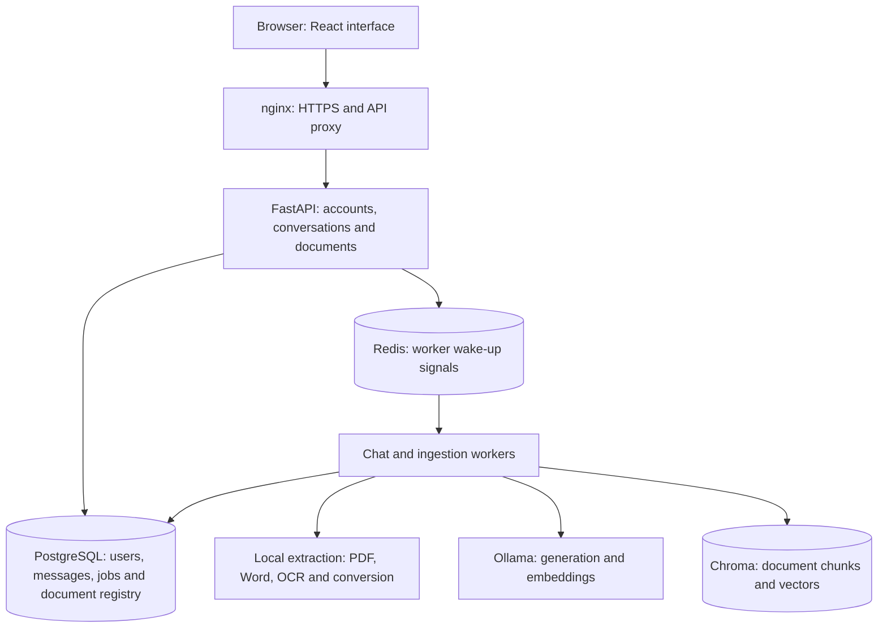

# Local RAG Platform

A local document assistant for standalone servers and disconnected networks. Administrators upload PDF or Word documents; users ask questions and receive answers with document references. Ollama runs both the language model and the embedding model on the server.

RAG means **retrieval-augmented generation**: the application finds relevant passages in your documents and supplies them to the model along with the question. The uploaded documents become a searchable knowledge base.

## What is implemented

| Area | Working functionality |
| --- | --- |
| Document ingestion | PDF, DOCX and legacy DOC uploads; Word paragraphs, tables, headers and footers; PDF page text; local English/Hebrew OCR for scanned pages |
| Knowledge management | Versioned document replacement, removal from search, and administrator-entered key/value knowledge facts |
| Questions and answers | Local semantic retrieval, recent conversation context, English/Hebrew answers, document/version/page citations, and insufficient-evidence responses |
| Conversations | Saved messages and citations, earlier conversation selection, pending-job recovery after a browser refresh, and account ownership checks |
| Administration | Create/list administrator and technician accounts; upload/remove documents; view processing jobs and failures |
| Access and operations | Local HTTPS, hashed passwords, server-side authentication, role checks, rate limits, dependency health checks, and retained job retries |
| Offline delivery | Bundled Docker images and Ollama models, Windows/Linux launchers, checksum verification, fresh installation credentials, and coordinated backup/restore tools |

The browser interface is in Hebrew with right-to-left layout. Answers follow the language of the question. Both roles use the shared knowledge base; conversation access is scoped to the signed-in account.

## How it works

### Turning documents into searchable knowledge

1. An administrator uploads a document. The API checks its format and size, saves the source locally, and records an ingestion job in PostgreSQL. Redis signals that work is available.
2. A background worker extracts text. Tesseract handles scanned pages; LibreOffice converts legacy Word files. These tools run locally.
3. The worker splits the extracted text into overlapping chunks, retaining source and version details and PDF page numbers where available.
4. Ollama runs `embeddinggemma` to represent each chunk as a vector for semantic search. Chroma stores the text and vectors.
5. PostgreSQL publishes the indexed document generation as active. A replacement becomes searchable after indexing succeeds; a failed replacement leaves the previous version available.

For example, uploading `Network_Guide_v2.docx` after `Network_Guide_v1.docx` updates the same topic. A separate base filename represents a separate topic.

### Answering a question

1. The API checks authentication, conversation ownership and rate limits, then creates a high-priority chat job. The browser receives a job ID immediately.
2. A chat worker retrieves relevant chunks from active document generations and adds bounded recent conversation history.
3. Ollama runs `qwen3:4b-instruct` with the question and that evidence. The prompt asks for references such as `[S1]` and an answer in the question's language.
4. The application checks that citation IDs refer to supplied evidence, then saves the answer, sources and job result in PostgreSQL. Missing evidence or invalid citation IDs produce an insufficient-evidence response.
5. The browser polls the job and displays the saved answer. Reloading the page can recover the conversation and pending work.

Citations identify the document, version and PDF page when available. Check important claims against the original source: valid citation IDs do not establish that every generated sentence is accurate.

## Architecture



PostgreSQL is the durable record of jobs and active document versions. Redis helps wake workers; the database retains queued work. Separate chat and background workers give questions priority over ingestion. Cleanup and optional website-sync workers handle maintenance.

The backend uses Python/FastAPI, SQLAlchemy and LangChain integrations; the frontend uses React/Vite and nginx. Docker Compose starts the services, initializes the database and waits for dependencies and required models.

## Run a prepared standalone package

The package targets **Linux amd64 containers** and requires **Docker Engine plus Compose 2.24.4 or newer** already installed. Windows Desktop uses Docker Desktop in Linux containers mode. For Windows Server, run the Linux package inside a Linux VM with Docker Engine; see [host requirements](docs/INSTALLATION.md).

The transfer archive contains application source, Docker images and both models. It excludes the preparation machine's documents, accounts and history. Host Python, Node and Ollama installations are unnecessary.

```text
tar -xf local-rag-standalone-2.2.0.tar
cd local-rag-standalone-2.2.0
```

Before the first launch, edit `run-config.json` to set `server_names` to the server's LAN hostname/IP and choose ports if the defaults are occupied.

| Platform | Start | Status | Stop |
| --- | --- | --- | --- |
| Windows Desktop | `RUN.cmd` | `RUN.cmd status` | `RUN.cmd stop` |
| Linux | `bash RUN.sh` | `bash RUN.sh status` | `bash RUN.sh stop` |

First launch verifies and imports the images/models, generates configuration and HTTPS certificates, starts the services, and creates an administrator with a random password. It starts with an **empty knowledge base**. The runner prints the address and login; the initial credentials are saved privately in `runtime/admin-login.txt`.

Trust the public certificate `app/deploy/tls/ca.crt` on browser clients, sign in over HTTPS, and upload your documents. Allow about 40 GB free disk for installation, plus space for documents and backups. Stopping preserves the data. Database content also lives in Docker named volumes; copying the application folder alone does not move it.

See [installation](docs/INSTALLATION.md), [daily operation](docs/RUNNING.md) and [backup/restore](deploy/BACKUP_RESTORE.md) for the complete procedures.

## Run from source

A fresh Git checkout contains code, dependency locks and example configuration. Building images and downloading models happen on a connected preparation machine. Follow [source installation](docs/INSTALLATION.md#prepare-from-source-on-a-connected-machine) before starting the application.

An already prepared checkout starts with:

```bash
bash server/scripts/start-local.sh
```

Runtime settings are defined in [.env.example](.env.example) and loaded from `.env`. The standalone runner generates `app/.env` from its run configuration. Models must match the configured names and be present locally.

The standalone deployment applies the internal-network overlay. For source deployments, use [the offline validation overlay](docs/TESTING.md#live-offline-acceptance) to enforce blocked backend internet access. The base Compose file keeps internal services unpublished but does not itself enforce that isolation.

## Repository layout

| Path | Purpose |
| --- | --- |
| `backend/app/` | API, authentication, database models, retrieval, ingestion, jobs and workers |
| `frontend/src/` | Chat interface, conversation recovery and administrator screens |
| `deploy/` | Image pins, Compose overrides, proxy/TLS configuration and deployment/recovery guides |
| `server/scripts/` | Release preparation, packaging, startup, certificate and backup/restore tools |
| `server/standalone/` | Portable launchers, installation helper, run configuration and installer tests |
| `redis/` | Redis runtime configuration |
| `tests/` | Application regressions, browser acceptance and live offline/recovery checks |
| `docs/` | Installation, operation, troubleshooting, testing and GitHub publishing instructions |

Application settings, permissions, version rules and database definitions are implemented in the Python code and active configuration. Dependency locks, tests and deployment scripts belong in the repository because they support reproducible setup and verification.

## What goes to GitHub

Publish the source, example configuration, lockfiles, tests and documentation. The following local installation files are excluded by `.gitignore`:

| Local files | Why they stay outside Git |
| --- | --- |
| `.env` and `runtime/` | Generated credentials and installation state |
| `data/` except `.gitkeep` | Uploaded documents, model stores and local account files |
| `deploy/tls/` and `deploy/pki/` | Installation certificates and private keys |
| `offline/` | Large release archives, model/image exports, private backups and recovery copies |
| Dependency/build caches and database exports | Generated content that is prepared separately |

The standalone transfer archive is about 7.37 GB and is distributed separately from the source repository. [Publishing instructions](docs/PUBLISHING.md) explain how to review the Git contents and push to your repository.

## Verification

Release validation on the preparation machine included:

| Check | Result |
| --- | --- |
| Python application regressions | 60 tests passed, plus 5 version identity examples |
| Standalone preparation and launcher tests | 29 checks passed |
| Release integrity tools | 6 checks passed |
| Production browser acceptance | 10 check groups passed |
| Fresh offline installation and live document/chat acceptance | 19 checks passed; repeat launch preserved configuration and credentials |

GitHub Actions is configured to run application/tool tests, shell syntax checks and a frontend build without Ollama models or private data. Actual OCR, local model generation, recovery and capacity checks use the prepared release environment. See [testing](docs/TESTING.md) for repeatable commands; verify the intended server separately.

## Defaults and practical limits

- The default deployment uses CPU execution and one generation at a time. GPU access requires additional host and Compose configuration; capacity depends on the selected models and hardware.
- OCR depends on scan quality. Encrypted, blank, damaged or unsupported documents can fail visibly during ingestion.
- Recent conversation context and retrieved evidence have bounded prompt budgets. A relevant document can still produce an incomplete answer.
- Default retention is seven days for chat messages and thirty days for finished jobs. Uploaded knowledge documents have no automatic expiry.
- Website synchronization and vision processing are implemented but disabled by default. Sync requires access to its configured site; vision requires an additional local model.
- Normal generation, embeddings and extraction require no cloud API. Telemetry and remote tracing are disabled in the supplied deployment configuration.

## Documentation

- [Installation and release preparation](docs/INSTALLATION.md)
- [Running the application](docs/RUNNING.md)
- [Troubleshooting and repairs](docs/TROUBLESHOOTING.md)
- [Testing and acceptance](docs/TESTING.md)
- [Publishing to GitHub](docs/PUBLISHING.md)
- [Backup and restore](deploy/BACKUP_RESTORE.md)
- [Detailed offline deployment](deploy/OFFLINE_DEPLOYMENT.md)
- [Optional two-server deployment](deploy/SPLIT_DEPLOYMENT.md)
